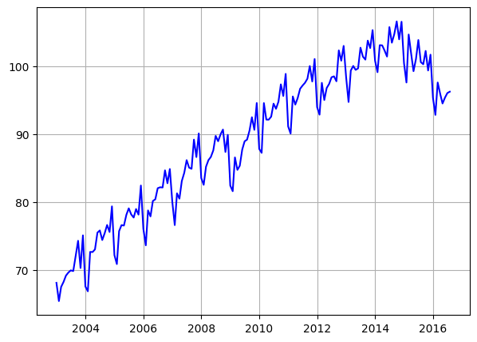

# Análise de Séries Temporais do IBCR Nordeste

## 1. Visão geral
O presente projeto foi realizado como avaliação final da disciplina de Econometria de Séries Temporais do curso de Economia da UFRN.
## 2. Objetivo do projeto
O objetivo desse projeto é realizar uma análise do IBCR Nordeste, um índice de atividade econômica calculado pelo Banco Central do Brasil, entre o período de 01/01/2003 até 31/08/2016, coincidindo com os mandatos presidenciais do Partido dos Trabalhadores, desde o presidente Lula até a presidenta Dilma de modo a captar se cada mandato tem efeito significante sobre o indicador. Reforço que esse relatório não tem posicionamento político.
## 3. Coleta de dados
Os dados foram coletados a partir do site do Banco Central do Brasil e disponíveis no link (https://api.bcb.gov.br/dados/serie/bcdata.sgs.25388/dados?formato=json). Nele está disponível a serie temporal completa.
Apresento abaixo o gráfico da série para o período estudado.

## 4. Metodologia

### 4.1. Limpeza de dados

### 4.2. Decomposição da variável

### 4.3. Testes de estacionariedade

### 4.4. Variáveis Dummies

### 4.5. Modelagem ARIMA

## 5. Resíduos

## 6. Resultados

## 7. Tecnologias e bibliotecas

## 8. Referências

# Estrutura do repositório
